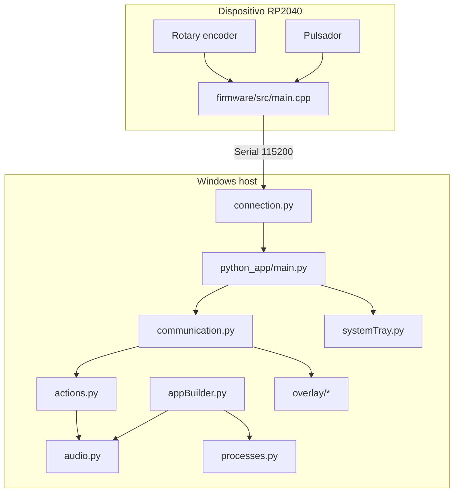

# Arquitectura

Megaknob esta dividido en dos dominios principales:

- **Hardware/firmware:** detecta eventos fisicos y los comunica como mensajes simples.
- **Host Windows:** interpreta mensajes y opera sobre audio, UI y estado de aplicacion.

## Diagrama de alto nivel

## Responsabilidades

| Area | Archivos | Responsabilidad |
| --- | --- | --- |
| Entrada fisica | `firmware/src/main.cpp` | Leer encoder/boton y emitir comandos seriales. |
| Conexion serial | `python_app/connection.py` | Encontrar el dispositivo, abrir COM, leer lineas y reconectar. |
| Loop principal | `python_app/main.py` | Inicializar Qt, overlay, tray, estado global y polling serial. |
| Enrutamiento | `python_app/communication.py` | Traducir comandos seriales en acciones de seleccion/volumen. |
| Acciones | `python_app/actions.py` | Capa fina entre comunicacion y audio/app builder. |
| Audio | `python_app/audio.py` | Usar PyCAW para leer, agrupar y cambiar volumen. |
| Procesos | `python_app/processes.py`, `config.py` | Resolver procesos reales a partir de sesiones de audio. |
| Estado | `python_app/models/app_state.py`, `audio_app.py`, `serial_com_result.py` | Modelos y estado compartido. |
| UI ligera | `python_app/overlay/*`, `systemTray.py` | Feedback visual y bandeja del sistema. |
| Startup | `python_app/startup.py` | Crear o eliminar acceso directo en Startup de Windows. |
| Instancia unica | `python_app/singleInstance.py` | Evitar multiples instancias con mutex de Windows. |

## Estado global

El estado compartido vive en `python_app/models/app_state.py`:

- `apps`: lista actual de `AudioApp`.
- `selectedIndex`: indice de la aplicacion seleccionada.

El loop principal inicializa ese estado con `appBuilder.refreshApps()` y luego lo actualiza cada vez que `communication.handleSerialCom()` devuelve un `SerialComResult`.

## Principio de integracion

El firmware no sabe nada de Windows ni de aplicaciones. Solo envia comandos.

La aplicacion Python no interpreta directamente hardware. Solo consume mensajes seriales normalizados.

Esta separacion hace que el contrato mas importante del proyecto sea el protocolo serial.
