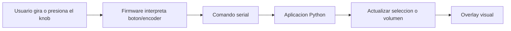

# Vision general

Megaknob resuelve un problema concreto: controlar el volumen de Windows y de aplicaciones individuales usando una sola perilla fisica.

En lugar de dedicar un deslizador fisico a cada aplicacion, el dispositivo usa dos modos:

- **Modo seleccion:** el encoder navega entre aplicaciones con audio activo.
- **Modo volumen:** el encoder modifica el volumen de la aplicacion seleccionada.

La aplicacion Python se encarga de descubrir las sesiones de audio, convertir procesos tecnicos en nombres mas amigables, aplicar cambios de volumen y mostrar feedback visual en pantalla.

## Componentes principales

- **Firmware RP2040:** lee el encoder y el boton, mantiene el modo local del dispositivo y envia comandos de texto por serial.
- **Aplicacion Python:** corre en Windows, escucha el puerto serial y ejecuta acciones sobre WASAPI mediante PyCAW.
- **Overlay:** muestra el icono o iniciales de la aplicacion seleccionada y un indicador circular de volumen.
- **System tray:** agrega icono en bandeja, salida de la aplicacion y toggle para iniciar con Windows.

## Flujo de usuario

## Estado actual

Segun el README y el changelog, el proyecto ya implementa:

- Control de volumen maestro.
- Control de volumen por aplicacion.
- Deteccion dinamica de sesiones de audio.
- Reconexion del dispositivo.
- Overlay de notificaciones.
- Integracion basica con bandeja del sistema.

Las mejoras planificadas incluyen mejor identificacion de procesos, interfaz grafica y documentacion detallada.
