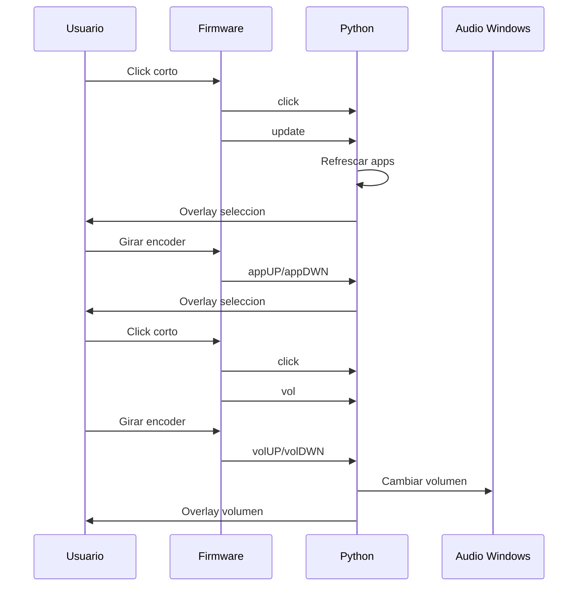

# Protocolo serial

El protocolo entre el firmware y la aplicacion Python es deliberadamente simple: comandos de texto enviados por puerto serial a 115200 baudios.

Cada comando se envia como una linea individual.

## Configuracion

| Propiedad | Valor |
| --- | --- |
| Baudrate | `115200` |
| Paridad | `PARITY_NONE` |
| Stop bits | `STOPBITS_ONE` |
| Bytesize | `EIGHTBITS` |
| Timeout Python | `0.01` s |
| VID detectado | `0x2E8A` |
| PID detectado | `0x000A` |

## Comandos

| Comando | Origen | Efecto en Python |
| --- | --- | --- |
| `click` | Click corto | Muestra overlay de seleccion para la app actual. |
| `update` | Click que entra a seleccion | Refresca lista de apps y muestra la seleccion actual. |
| `master` | Pulsacion larga | Selecciona `master`, muestra overlay de volumen. |
| `appUP` | Encoder en modo seleccion | Avanza seleccion circularmente. |
| `appDWN` | Encoder en modo seleccion | Retrocede seleccion circularmente. |
| `volUP` | Encoder en modo volumen | Sube volumen maestro o de app seleccionada. |
| `volDWN` | Encoder en modo volumen | Baja volumen maestro o de app seleccionada. |
| `vol` | Click que entra a volumen | Muestra overlay de volumen para la app actual. |

## Flujo habitual

## Manejo de comandos desconocidos

Si Python recibe un mensaje no reconocido, `communication.handleSerialCom()` conserva el estado actual y devuelve un `SerialComResult` con mensaje de debug `Unknown message: ...`.
